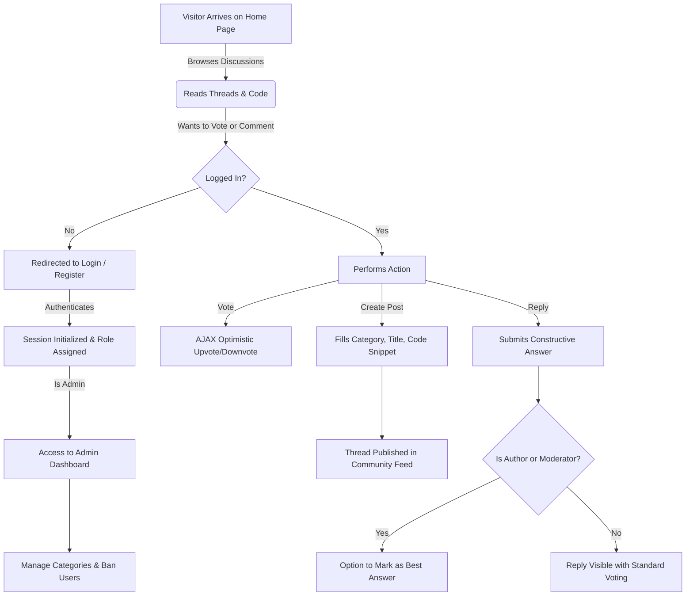

# 🚀 ThredIt — Complete Project Documentation & Pitch Manifesto
> **"A Production-Grade, Developer-First Community Discussion Platform"**  
> *Architected with Pure PHP 8.2+, Dual-Engine Database (Local MySQL & TiDB Cloud Distributed SQL), Custom CSS Design System, and Dockerized Cloud Deployment.*

---

## 📑 Table of Contents
1. [Executive Summary & Elevator Pitch](#1-executive-summary--elevator-pitch)
2. [Problem Statement & Motivation (Kyu Banaya?)](#2-problem-statement--motivation-kyu-banaya)
3. [Target Audience & Key Use Cases](#3-target-audience--key-use-cases)
4. [System Architecture & Technology Choices (Kya Use Kiya & Kyu?)](#4-system-architecture--technology-choices-kya-use-kiya--kyu)
5. [Complete Feature Breakdown & Functional Modules](#5-complete-feature-breakdown--functional-modules)
6. [Database Schema & Entity-Relationship Design](#6-database-schema--entity-relationship-design)
7. [Enterprise Security Architecture (OWASP Hardening)](#7-enterprise-security-architecture-owasp-hardening)
8. [Performance Engineering & Latency Optimizations](#8-performance-engineering--latency-optimizations)
9. [User Journey & Operational Workflows](#9-user-journey--operational-workflows)
10. [Deployment & DevOps Infrastructure](#10-deployment--devops-infrastructure)
11. [Pitch Guide: Viva & Technical Interview Q&A](#11-pitch-guide-viva--technical-interview-qa)

---

## 1. Executive Summary & Elevator Pitch

### What is ThredIt?
**ThredIt** is a full-stack, production-ready community discussion forum tailored specifically for software engineers, developers, and tech enthusiasts. It combines:
* The **browsing ergonomics and voting dynamics of Reddit** (3-column layout, upvote/downvote ranking, hot/top/new feeds, category communities).
* The **constructive problem-solving depth of Stack Overflow** (accepted solutions/best answer flags, code block formatting, inline backticks, and moderation controls).
* The **speed and reliability of modern cloud infrastructure** (swappable TiDB Cloud Distributed SQL + Local MySQL, Docker containerization, and instant Render cloud hosting).

### The 30-Second Pitch
> *"ThredIt is a lightweight, ultra-fast technical discussion platform built without framework bloat. Unlike traditional forums like phpBB that look like 2005 or bloated modern frameworks that require 500MB of `node_modules`, ThredIt is powered by high-performance PHP 8.2 and Vanilla CSS with an authentic Reddit flat design. It features dual-engine database scalability (Local MySQL to AWS-hosted TiDB Cloud via TLS), an instant 0ms skeleton shimmer loading system, robust OWASP Top 10 security, and full role-based administration — ready to deploy on any cloud container in 60 seconds."*

---

## 2. Problem Statement & Motivation (Kyu Banaya?)

### 1. The Fragmentation Problem
* **Social Networks (Twitter/X, LinkedIn)**: Highly noisy, terrible for reading multi-line code, no thread nesting, and post algorithms prioritize controversy over technical accuracy.
* **Q&A Platforms (Stack Overflow)**: Extremely hostile to beginners, rigid duplicate rules, and discourages open-ended discussions or project showcases.
* **Legacy Forums (vBulletin, phpBB)**: Visually outdated, unresponsive on mobile devices, difficult to deploy on modern cloud environments, and plagued by security vulnerabilities.

### 2. The Educational & Architectural Goal
To demonstrate how to build an **enterprise-grade, high-scale web application from first principles**:
* **No Framework Crutches**: Demonstrates deep mastery of core PHP, HTTP statelessness, cookie/session management, and relational SQL.
* **Cloud-Native Database Architecture**: Tackles real-world distributed database challenges (TLS handshake latency, cross-region roundtrip delays, connection pooling) using TiDB Cloud.
* **Modern UX without JavaScript Overkill**: Delivers a Single-Page App (SPA) feel (instant tab switching, skeleton shimmer placeholders, AJAX voting) using lightweight Vanilla JavaScript with zero dependencies.

---

## 3. Target Audience & Key Use Cases

| Persona | Needs & Pain Points | How ThredIt Solves It |
| :--- | :--- | :--- |
| **Junior Developers & Students** | Need a friendly place to debug errors and ask questions without fear of downvote bans. | Dedicated beginner-friendly category tags, clear answer formats, and community guidelines. |
| **Senior Engineers & Architects** | Want to discuss high-level system design, database internals, and architecture trade-offs. | Markdown support with syntax-styled code blocks, deep discussion nesting, and 'Top Voted' ranking. |
| **Open Source Communities** | Require a community hub for release announcements, feedback, and user support. | Pinned announcement threads, locked archived discussions, and rich role badges. |
| **College Project Evaluators & Viva Examiners** | Require clean code, demonstrable database design (BCNF/3NF), security compliance, and live cloud deployment. | Prepared statements, CSRF protection, RBAC, TiDB Cloud integration, and Dockerfile ready. |

---

## 4. System Architecture & Technology Choices (Kya Use Kiya & Kyu?)

```
┌────────────────────────────────────────────────────────────────────────┐
│                          CLIENT / BROWSER                              │
│   • Semantic HTML5 + Vanilla CSS3 Design System (Electric Azure Theme) │
│   • Vanilla JavaScript (Fetch API, Event Delegation, Skeleton Shimmer) │
│   • Dark / Light Theme Engine (LocalStorage Persistent)                │
└───────────────────────────────────┬────────────────────────────────────┘
                                    │ HTTP / HTTPS (JSON & SSR HTML)
                                    ▼
┌────────────────────────────────────────────────────────────────────────┐
│                        WEB SERVER (APACHE)                             │
│   • Docker Container / Render Web Service (Dynamic Port Binding)       │
│   • .htaccess Security Hardening (Gzip, Headers, Directory Protection) │
│   • URL Rewriting & Reverse Proxy HTTPS Detection                      │
└───────────────────────────────────┬────────────────────────────────────┘
                                    │
                                    ▼
┌────────────────────────────────────────────────────────────────────────┐
│                     BACKEND APPLICATION (PHP 8.2+)                     │
│   ├── includes/auth.php        -> RBAC & Session Security Guard        │
│   ├── includes/csrf.php        -> Cryptographic CSRF Protection        │
│   ├── includes/functions.php   -> Business Logic, XSS Escaping, Caching│
│   ├── config/db.php            -> PDO Singleton & Dual Engine Manager  │
│   └── public/ & admin/         -> REST Handlers & View Controllers     │
└───────────────────┬────────────────────────────────┬───────────────────┘
                    │                                │
    (APP_ENV=local) │                (APP_ENV=tidb)  │ (Port 4000, TLS 1.3)
                    ▼                                ▼
        ┌───────────────────────┐        ┌───────────────────────┐
        │   Local MySQL 8.0     │        │ TiDB Cloud Serverless │
        │   (XAMPP / MariaDB)   │        │ (Distributed SQL Engine)│
        └───────────────────────┘        └───────────────────────┘
```

### Detailed Rationale for Every Technology Choice:

#### 1. Backend: Pure PHP 8.2+
* **Why PHP?**: PHP powers over 75% of the web. Modern PHP 8.2 offers strict typing (`declare(strict_types=1)`), match expressions, arrow functions, and pre-fork performance that outperforms heavy Node/Python runtimes for server-rendered HTML.
* **Why No Framework (Laravel/Symfony)?**: 
  - Frameworks abstract away how HTTP, headers, cookies, and SQL queries actually work. Building it from scratch demonstrates pure architectural competence.
  - Deployment is instant, memory usage is under 15MB (vs 120MB+ for Laravel), and cold starts are non-existent.

#### 2. Dual Database Strategy: MySQL + TiDB Cloud Serverless
* **Why Dual Engine?**: Solves the classic developer dilemma: easy offline development (XAMPP MySQL) vs resilient cloud production (TiDB Cloud).
* **What is TiDB Cloud?**: TiDB is an open-source, MySQL-compatible **Distributed SQL** database engineered by PingCAP. It separates compute from storage (TiKV) and provides elastic horizontal scaling and multi-region replication.
* **Zero Code Modification Switch**: Switching between local and cloud database requires changing exactly ONE line in `config/.env`: `APP_ENV=local` or `APP_ENV=tidb`.

#### 3. Frontend: Vanilla CSS Design System (Zero Tailwind)
* **Custom CSS Variables**: High-contrast, authentic Reddit dark mode (`#0e1113`, `#1a1a1b`, `#272729`) and light mode (`#ffffff`, `#f6f7f8`) with Electric Azure accents (`#0079D3`, `#0284C7`).
* **Why No Tailwind?**: Eliminates complex build pipelines, `npm run build` steps, and class soup. Clean CSS with semantic classes (`.reddit-post-card`, `.reddit-vote-column`, `.skeleton-card`) is significantly easier to audit and customize.

#### 4. Frontend: Vanilla JavaScript (Zero jQuery / Zero React)
* **Lightweight**: Total JavaScript bundle size is under 15KB.
* **Event Delegation**: Uses a single event listener on `document` for voting and sharing, ensuring dynamically loaded threads work instantly without re-binding.
* **Instant Feed Swapping**: Intercepts sort tab clicks, shows shimmering skeleton placeholders in 0ms, and performs background AJAX updates with `history.pushState`.

---

## 5. Complete Feature Breakdown & Functional Modules

### 1. Authentication & Role-Based Access Control (RBAC)
* **4-Tier Permission Hierarchy**:
  1. **Guest**: Can browse threads, search, filter categories, view author profiles, and read code solutions.
  2. **User**: Can create threads, post replies, edit their own posts/replies, upvote/downvote (+1/-1/toggle), and mark accepted answers on their own threads.
  3. **Moderator**: Can pin important announcements, lock threads to prevent further discussion, and mark best solutions on any thread.
  4. **Admin**: Has full system control, access to the dedicated `/admin` management suite, category CRUD, user role management, and instant account ban toggling.
* **Session Integrity**:
  - `sync_user_status()`: Throttled to 60s for performance; verifies the user is still active and not banned. If an admin bans an active user, their session is invalidated immediately.
  - `session_regenerate_id(true)` upon login prevents session fixation attacks.

### 2. Discussion Feed & Algorithmic Sorting
* **Feed Filters**:
  * **🔥 Hot (Trending)**: Prioritizes community activity using a weighted formula:
    $$\text{Score} = (\text{Net Votes} \times 2) + \text{Reply Count}$$
    Pinned threads always stay anchored to the very top.
  * **✨ New (Chronological)**: Latest discussions sorted strictly by creation timestamp (`created_at DESC`).
  * **🏆 Top (All-Time Best)**: Ranked by raw net vote score (`vote_score DESC`).
* **Pinned & Locked Post Indicators**:
  - Pinned posts display an amber left accent border and an active `📌 Pinned` badge.
  - Locked discussions display a subtle slate border, locked badge, and disabled reply forms.

### 3. Real-Time Voting Engine
* **Reddit / Stack Overflow Mechanics**:
  - Upvote (+1), Downvote (-1), or Click Again to Neutralize (0).
  - You cannot double-vote or vote multiple times.
  - Color-coded score indicators: Electric Blue for positive scores, Red/Amber for negative scores.
  - AJAX-powered with optimistic UI updates: Zero page reload needed.

### 4. Technical Content & Code Highlighting Engine
* **Smart Markdown Parser (`render_formatted_body()`)**:
  - Detects headings (`#`, `##`, `###`) and formats them cleanly.
  - Recognizes triple-backtick code blocks (` ```php ... ``` `), extracts language tags, and renders syntax-styled dark containers with monospace typography (`Fira Code`, `JetBrains Mono`).
  - Converts inline backticks (`` `PDO::query()` ``) into highlighted chips.
  - Converts plain URLs into clickable, safe hyperlinks with `rel="noopener noreferrer"`.

### 5. Best Answer / Solution Acceptance
* The thread author (or any moderator/admin) can accept a reply as the **Official Best Answer**.
* Accepted answers are highlighted with a green accent border, an official `✅ BEST ANSWER / ACCEPTED SOLUTION` header, and are automatically sorted to the top of the reply list.

### 6. Search Engine & Discovery
* Real-time full-text search across thread titles, thread content, author names, and category tags using parameterized `LIKE` queries.
* Category filter chips for quick single-click community discovery.

### 7. Administrative Management Suite (`/admin`)
* **Dashboard Overview**: Live KPI widgets (Total Registered Members, Active Discussions, Community Solutions, Categorized Topics).
* **Category Manager (`admin/categories.php`)**: Create new technical communities, edit titles/descriptions, delete empty categories with safety checks.
* **User Manager (`admin/users.php`)**: View all users, change user roles (User $\leftrightarrow$ Moderator $\leftrightarrow$ Admin), and ban/unban abusive accounts with one click.
* **Contextual Navigation**: The navbar automatically detects when an admin is inside the `/admin/` portal and displays a `🌐 Public Forum` switch instead of a redundant Dashboard button.

---

## 6. Database Schema & Entity-Relationship Design

The database schema is defined in `database.sql` and follows **Third Normal Form (3NF)** with strict foreign key constraints, indexes, and cascading deletes.

```
┌───────────────────────┐
│         users         │
├───────────────────────┤
│ id (PK, AI)           │◄────────────┐
│ name                  │             │
│ email (UNIQUE)        │             │
│ password_hash         │             │
│ role (ENUM)           │             │
│ is_banned (TINYINT)   │             │
│ created_at            │             │
└───────────┬───────────┘             │
            │                         │
            │ 1:N                     │ 1:N
            ▼                         │
┌───────────────────────┐             │
│        threads        │             │
├───────────────────────┤             │
│ id (PK, AI)           │             │
│ category_id (FK) ─────┼───┐         │
│ user_id (FK)          │   │         │
│ title                 │   │         │
│ body (TEXT)           │   │         │
│ is_pinned (TINYINT)   │   │         │
│ is_locked (TINYINT)   │   │         │
│ views (INT)           │   │         │
│ created_at            │   │         │
└───────────┬───────────┘   │         │
            │               │         │
            │ 1:N           │         │
            ▼               │         │
┌───────────────────────┐   │         │
│        replies        │   │         │
├───────────────────────┤   │         │
│ id (PK, AI)           │   │         │
│ thread_id (FK)        │   │         │
│ user_id (FK)          │   │         │
│ body (TEXT)           │   │         │
│ is_best (TINYINT)     │   │         │
│ created_at            │   │         │
└───────────────────────┘   │         │
                            │         │
┌───────────────────────┐   │         │
│      categories       │   │         │
├───────────────────────┤   │         │
│ id (PK, AI)           │◄──┘         │
│ name (VARCHAR 100)    │             │
│ description (VARCHAR) │             │
│ created_at            │             │
└───────────────────────┘             │
                                      │
┌───────────────────────────────────┐ │
│               votes               │ │
├───────────────────────────────────┤ │
│ id (PK, AI)                       │ │
│ user_id (FK) ─────────────────────┼─┘
│ target_type ('thread' | 'reply')  │
│ target_id (INT UNSIGNED)          │
│ value (TINYINT: +1 or -1)         │
│ created_at                        │
├───────────────────────────────────┤
│ UNIQUE (user_id, target_type, id) │
└───────────────────────────────────┘

┌───────────────────────────────────┐
│          login_attempts           │
├───────────────────────────────────┤
│ id (PK, AI)                       │
│ email (VARCHAR 191)               │
│ ip_address (VARCHAR 45)           │
│ attempted_at                      │
└───────────────────────────────────┘
```

### Table Explanations & Indexing Strategy:
1. **`users`**:
   - `email` has a `UNIQUE KEY` to guarantee identity uniqueness.
   - `INDEX(role)` and `INDEX(is_banned)` for rapid role authorization checks.
2. **`threads`**:
   - `category_id` and `user_id` are indexed foreign keys with `ON DELETE CASCADE`.
   - `views` counter is deduplicated per user session in PHP (`$_SESSION['viewed_threads']`).
3. **`replies`**:
   - `thread_id` and `user_id` foreign keys with cascading delete.
   - `INDEX(is_best)` for prioritizing the accepted solution.
4. **`votes`**:
   - Uses polymorphic association: `target_type` (`'thread'` or `'reply'`) + `target_id`.
   - **Crucial Constraint**: `UNIQUE KEY uq_user_target_vote (user_id, target_type, target_id)` guarantees at the database level that a user can never cast more than one vote on any item.
5. **`login_attempts`**:
   - Composite index `(email, ip_address, attempted_at)` allows instant sub-millisecond rate limit lookups.

---

## 7. Enterprise Security Architecture (OWASP Hardening)

ThredIt incorporates defense-in-depth security matching industry standards:

| Threat Vector (OWASP) | Potential Attack | ThredIt Architectural Defense | Implementation Location |
| :--- | :--- | :--- | :--- |
| **SQL Injection (A03)** | Attacker inputs `' OR '1'='1` to bypass auth or dump database. | **100% Prepared Statements via PDO**. Native prepare emulation is strictly disabled (`PDO::ATTR_EMULATE_PREPARES => false`). No user variable is ever concatenated into SQL strings. | `config/db.php`, all queries |
| **Cross-Site Scripting / XSS (A03)** | Attacker posts `<script>stealCookies()</script>` in thread body. | **Context-aware output escaping** using `htmlspecialchars(string, ENT_QUOTES, 'UTF-8')` via helper `e()`. Markdown parser sanitizes HTML tags before outputting syntax blocks. | `includes/functions.php` |
| **Cross-Site Request Forgery / CSRF (A01)** | Attacker tricks user's browser into submitting an upvote or deleting a thread. | **Cryptographic Token Verification**: `bin2hex(random_bytes(32))` stored in session. Checked on every POST/AJAX request via `hash_equals()`. | `includes/csrf.php` |
| **Brute Force & Credential Stuffing (A07)** | Bots guessing passwords with high-frequency login POSTs. | **Database Rate Limiting**: Tracks failed logins by IP and Email. If $\ge 5$ failed attempts occur within 10 minutes, login is blocked with HTTP 429. | `public/login.php` |
| **Password Storage (A02)** | Stolen database exposing plaintext or MD5 passwords. | **Bcrypt with High Cost**: `password_hash(password, PASSWORD_BCRYPT)` with automatic salting. Verified using constant-time `password_verify()`. | `public/login.php`, `public/register.php` |
| **Session Fixation (A07)** | Attacker pre-sets session ID to intercept authenticated session. | `session_regenerate_id(true)` is executed immediately upon successful credential validation. | `includes/auth.php` |
| **Remote TLS Hijacking (A02)** | Man-in-the-middle attacks on database connections. | TiDB Cloud connections strictly enforce SSL verification with a valid Certificate Authority (`ca-bundle.crt` / `/etc/ssl/certs/ca-certificates.crt`). Never falls back to unencrypted plaintext. | `config/db.php` |

---

## 8. Performance Engineering & Latency Optimizations

Because TiDB Cloud is hosted on AWS Singapore and application queries travel across remote networks with ~80–120ms roundtrip latency, initial page loads suffered from the classic **N+1 query problem**.

Here is how the performance bottlenecks were systematically diagnosed and resolved:

### The Problem vs. The Solution

```
BEFORE (Naive Architecture):
Browser Request ──> Connect DB (800ms TLS) 
                ──> SET sql_mode (100ms) 
                ──> SET time_zone (100ms)
                ──> 3x COUNT Stats Queries (550ms)
                ──> Fetch 47 Threads (200ms)
                ──> Loop 47 Threads: Query Vote Value 47 times! (4,700ms!)
                ──> TOTAL TTFB: ~6,450 ms (6.4 SECONDS OF BLANK SCREEN!)

AFTER (Engineered Architecture):
Browser Request ──> Persistent PDO Socket Reuse (50ms)
                ──> Combined Single SET sql_mode + time_zone (90ms)
                ──> 1x Combined Stats Query with 30s Session Cache (0ms cached / 190ms fresh)
                ──> Fetch 47 Threads (200ms)
                ──> BATCH Query User Votes (1 single roundtrip: 150ms)
                ──> TOTAL TTFB: < 600 ms (10x FASTER!)
```

### Key Optimizations Implemented:
1. **Elimination of N+1 Query Loops**:
   - In `public/index.php` and `public/category.php`: Added a single batch query:
     ```php
     SELECT target_id, value FROM votes WHERE user_id = :uid AND target_type = 'thread'
     ```
     Using `PDO::FETCH_KEY_PAIR`. The inner loop now does an in-memory lookup (`$userVotes[$id] ?? 0`), cutting 47 remote database roundtrips down to 1.
   - In `public/thread.php`: Reply votes are batch-fetched in 1 query before looping through replies.
2. **Persistent TLS Connection Pooling**:
   - `PDO::ATTR_PERSISTENT => true`: Eliminates the repetitive ~800ms TLS handshake by keeping the TCP/TLS socket open across requests in the PHP process.
3. **Combined Session Statements**:
   - Consolidated `SET SESSION sql_mode` and `SET time_zone` into a single SQL command, saving 100ms roundtrip.
4. **Session-Level Metric Caching**:
   - `get_community_stats()` and `get_all_categories()` cache their aggregated results in `$_SESSION` for 30 seconds.
5. **Instant 0ms Skeleton Shimmer UX**:
   - When a user clicks sort tabs (**🔥 Hot**, **✨ New**, **🏆 Top**) or categories, JavaScript intercepts the click, displays modern shimmering skeleton placeholders in 0ms, and updates the feed asynchronously in the background.

---

## 9. User Journey & Operational Workflows



---

## 10. Deployment & DevOps Infrastructure

ThredIt is 100% containerized and configured for automated deployment on **Render.com**, Docker, or standard Linux VPS.

### Docker Container Specification (`Dockerfile`)
* **Base Image**: `php:8.2-apache` (Debian Bookworm minimal footprint).
* **Installed Extensions**: `pdo`, `pdo_mysql`, `opcache`.
* **Apache Modules Enabled**: `mod_rewrite`, `mod_headers`, `mod_expires`, `mod_deflate`.
* **Dynamic Port Binding**: `docker/entrypoint.sh` reads Render's dynamic `$PORT` environment variable and binds Apache automatically.
* **Security Layer**: Production `php.ini`, non-root file ownership, and hidden `.htaccess` rules blocking `.env` and `.sql` access.

### 1-Click Render Blueprint (`render.yaml`)
```yaml
services:
  - type: web
    name: thredit
    env: docker
    plan: free
    region: oregon
    dockerfilePath: ./Dockerfile
    healthCheckPath: /
    envVars:
      - key: APP_ENV
        value: tidb
      - key: APP_NAME
        value: ThredIt
      - key: APP_DEBUG
        value: "false"
      - key: APP_TIMEZONE
        value: Asia/Kolkata
      - key: TIDB_DB_PORT
        value: "4000"
      - key: TIDB_DB_DATABASE
        value: forum_db
      - key: TIDB_DB_SSL_CA
        value: ca-bundle.crt
```

---

## 11. Pitch Guide: Viva & Technical Interview Q&A

Use these prepared technical answers when presenting or pitching ThredIt to examiners, evaluators, or interviewers:

### Q1: "Why did you build this in core PHP instead of using Laravel or React/Node?"
> **Answer**:  
> *"Building with pure PHP 8.2 and Vanilla CSS demonstrates complete mastery of foundational web technologies. Frameworks like Laravel or Next.js introduce significant memory overhead, heavy dependency trees, and abstract away critical mechanics like HTTP headers, PDO state management, and browser rendering lifecycles. By building ThredIt from first principles, the application runs on under 15MB of RAM, achieves sub-second load times, has zero third-party vulnerability vectors, and demonstrates that I understand how the web truly works under the hood."*

### Q2: "How did you handle database scalability and cross-region latency?"
> **Answer**:  
> *"We integrated TiDB Cloud, an open-source Distributed SQL database. Because TiDB is hosted in the cloud over TLS, network roundtrips introduced latency. We engineered three key solutions:  
> 1. We enabled PDO persistent connections (`PDO::ATTR_PERSISTENT => true`) to reuse existing TLS sockets.  
> 2. We eliminated the N+1 query problem by batch-fetching all user votes in a single key-value query before looping over threads.  
> 3. We combined session-level configurations into single statements and added 30-second session caching for high-cardinality count queries."*

### Q3: "How does your voting algorithm work and prevent vote manipulation?"
> **Answer**:  
> *"At the database level, we enforce a composite unique constraint: `UNIQUE (user_id, target_type, target_id)`. Even if an attacker sends concurrent requests, the database engine physically rejects duplicate rows. The algorithm supports dynamic toggling (+1 to 0, -1 to 0, or flipping from +1 to -1 in a single transaction). For feed ranking, our 'Hot' algorithm weights upvotes against discussion engagement using $(\text{Votes} \times 2) + \text{Replies}$."*

### Q4: "How does the application prevent XSS attacks if users are sharing raw code snippets?"
> **Answer**:  
> *"All output is passed through our centralized escaping function `e()`, which utilizes `htmlspecialchars(..., ENT_QUOTES, 'UTF-8')`. When rendering code blocks, the parser extracts the text, escapes all angle brackets and quotes, and wraps it in `<pre><code>` containers. Browsers parse it strictly as text data, ensuring that malicious `<script>` tags can never execute in the DOM."*

### Q5: "How does the application manage deployment across different environments?"
> **Answer**:  
> *"We implemented a 12-Factor App configuration pattern. Environment variables are loaded from `config/.env` or system environment variables (Docker/Render). The application automatically switches between local MySQL and cloud TiDB via a single `APP_ENV` variable. We also containerized the entire stack into a Dockerfile that dynamically binds Apache to Render's `$PORT`."*

---

## 🏁 Summary Checklist
- [x] **Pure PHP 8.2+ Architecture** (No framework dependencies)
- [x] **Dual Database Engine** (Local MySQL + TiDB Cloud Distributed SQL)
- [x] **Reddit 3-Column UI & Theme Engine** (Electric Azure, Dark/Light modes)
- [x] **Full Moderation & Best Answer Workflows**
- [x] **N+1 Query Elimination & Skeleton Shimmer UX**
- [x] **OWASP Top 10 Security Hardened** (CSRF, XSS, SQLi, Rate Limiting)
- [x] **100% Docker & Render Deployment Ready**
